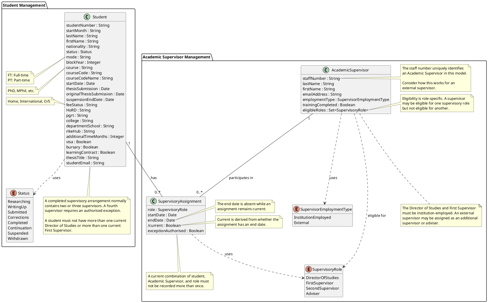

# Week 4 Domain Model: Students and Academic Supervisors

## Purpose

This domain model extends the Week 3 `Student` model by representing Academic Supervisors as separate entities.

The `SupervisoryAssignment` entity represents the relationship between a student and an Academic Supervisor. It records information that belongs to an assignment, including supervisory role and effective dates.

The model is a starting point for Week 4. Review it alongside the Week 4 use-case descriptions and decide which attributes are required by your implementation.

## Understanding the Supervisor Model

In the previous model, supervisor names could be stored directly in `Student`. This becomes difficult when one supervisor works with several students, holds different roles, or changes role over time.

Week 4 therefore introduces two concepts.

### AcademicSupervisor

`AcademicSupervisor` represents an individual supervisor and holds information such as:

- Staff number
- Name
- Email address
- Employment type
- Training information
- Eligible supervisory roles

The same supervisor record can be associated with several students.

### SupervisoryAssignment

`SupervisoryAssignment` links one student to one Academic Supervisor.

It records information that belongs to the relationship:

- Supervisory role
- Start date
- End date
- Authorised exception, where applicable

The role belongs to the assignment because the same supervisor may hold different roles for different students.

### Supervisory Roles

The supplied roles are:

- `DirectorOfStudies`
- `FirstSupervisor`
- `SecondSupervisor`
- `Adviser`

A supervisor may be eligible for some roles but not others. This is represented by:

```text
eligibleRoles : Set<SupervisoryRole>
```

### Current and Historical Assignments

An assignment with no end date is current. In the model, `/current` is derived from `endDate` rather than stored separately.

When an assignment ends, its end date is recorded so that the supervisory history is retained.

### Relationships

- A student can have several supervisory assignments.
- An Academic Supervisor can supervise several students.
- Each assignment links exactly one student and one Academic Supervisor.

Before implementation, decide which fields are required and how eligibility, external supervisors, training, exceptions, and assignment history will be represented.

## Domain Model



## Key Changes from Week 3

- `dos`, `firstSupervisor`, and `secondSupervisor` have been removed from `Student`.
- `AcademicSupervisor` is represented as an entity with its own identifier and attributes.
- `SupervisoryAssignment` resolves the conceptual many-to-many relationship between students and Academic Supervisors.
- `SupervisoryRole` represents the role held within an individual assignment.
- `SupervisorEmploymentType` distinguishes institution-employed and external supervisors.
- `eligibleRoles` allows eligibility to differ by supervisory role.
- Assignment dates allow current and historical supervisory relationships to be retained.
- `current` is derived from the absence or presence of `endDate` rather than stored separately.
- `exceptionAuthorised` can record whether an assignment requiring an exception has been authorised.

## Design Decisions

Before implementation, decide:

- Which suggested attributes are required by the Week 4 use cases.
- Which attributes are mandatory or optional.
- How staff numbers are handled for institution-employed and external supervisors.
- Whether `eligibleRoles` is stored directly or derived from employment and training information.
- Whether additional information is needed to explain why a supervisor is eligible for a role.
- Whether an assignment requires an end reason.
- What information is required to authorise an exception.
- Whether additional training details or dates are required.
- How Academic Supervisors and assignments are displayed and ordered.

Record any changes made to this model. Keep the domain model, use cases, module operations, views, and implementation consistent.
