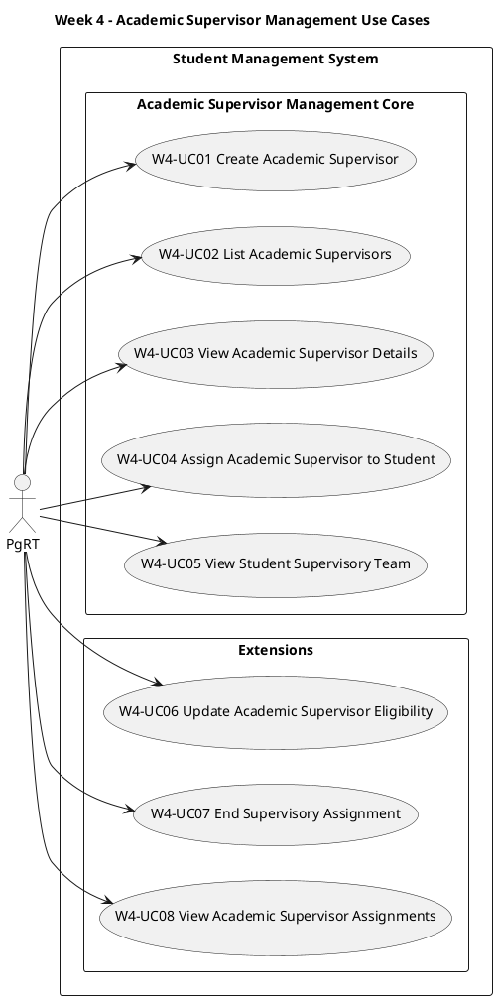

# Week 4 Use-Case Descriptions

## Purpose

Week 4 continues the Student Management application developed in Weeks 2 and 3.

The existing student-management behaviour remains part of the application. Week 4 introduces Academic Supervisors as a separate domain concept and adds use cases for managing supervisors and their assignments to students.

The use cases describe externally observable behaviour. The Week 4 lab instructions will explain how this behaviour is organised within a modular monolith.

## Requirements Traceability

The Week 4 use cases support:

- **US002:** Assign and manage supervisory roles
- **US008:** Track supervisor training and eligibility
- **FR04:** Supervisor Assignment Management
- **BR01:** Every student must have at least one institution-employed Director of Studies and one institution-employed First Supervisor
- **BR02:** A completed supervisory arrangement normally contains between two and three supervisors
- **BR03:** A fourth supervisor requires an authorised exception
- **BR13:** An external supervisor may be an additional supervisor or adviser but cannot replace the institution-employed Director of Studies or First Supervisor
- **BR14:** A student must not have more than one current Director of Studies or more than one current First Supervisor
- **BR15:** The same current student, supervisor, and supervisory-role combination must not be recorded more than once

The creation, listing, and details use cases provide supporting operations needed to manage Academic Supervisor records and supervisory assignments.

## Domain-Model Decisions

The Week 4 domain model will be provided in a separate file. Review that model alongside this use-case document before beginning the implementation.

The supplied model provides the starting point for the Academic Supervisor and supervisory-assignment concepts. You must decide which attributes and relationships are required by your implementation and apply those decisions consistently.

For the Academic Supervisor concept, decide:

- Which attributes uniquely identify a supervisor.
- Which attributes are mandatory or optional.
- How institution-employed and external supervisors are distinguished.
- How training and eligibility information is represented.
- Which fields appear in list, details, and creation views.

For the supervisory-assignment concept, decide:

- How a student and Academic Supervisor are referenced.
- How the supervisory role is represented.
- How current and historical assignments are distinguished.
- How start and end dates are represented.
- How authorised exceptions are recorded.

Record any changes you make to the separately supplied domain model. Keep this use-case document, the revised domain model, module operations, views, and implementation consistent with those decisions.

## Use-Case Summary

| Use Case ID | Origin | Related Requirements | Use Case | Primary Actor | Classification |
|---|---|---|---|---|---|
| W4-UC01 | Supporting operation | FR04 | Create Academic Supervisor | PgRT | New Week 4 core |
| W4-UC02 | Supporting operation | FR04 | List Academic Supervisors | PgRT | New Week 4 core |
| W4-UC03 | Supporting operation | FR04 | View Academic Supervisor Details | PgRT | New Week 4 core |
| W4-UC04 | US002 | FR04, BR01, BR02, BR03, BR13, BR14, BR15 | Assign Academic Supervisor to Student | PgRT | New Week 4 core |
| W4-UC05 | US002 | FR04 | View Student Supervisory Team | PgRT | New Week 4 core |
| W4-UC06 | US008 | FR04 | Update Academic Supervisor Eligibility | PgRT | Week 4 extension |
| W4-UC07 | US002 | FR04, BR01, BR02, BR14 | End Supervisory Assignment | PgRT | Week 4 extension |
| W4-UC08 | US002 | FR04 | View Academic Supervisor Assignments | PgRT | Week 4 extension |

## Use-Case Diagram

# Core Use-Case Descriptions

## W4-UC01: Create Academic Supervisor

**Supports:** FR04  
**Primary Actor:** PgRT  
**Classification:** Core

### Goal

Create an Academic Supervisor record so that the supervisor can be considered for assignment to students.

### Preconditions

- The Student Management System is available.
- The PgRT can access Academic Supervisor Management.

### Trigger

The PgRT selects **Create Academic Supervisor**.

### Main Success Scenario

- The PgRT requests to create an Academic Supervisor.
- The system displays the Academic Supervisor creation form.
- The PgRT enters the required supervisor information.
- The PgRT may enter optional supervisor information.
- The PgRT submits the information.
- The system determines that the required information has been supplied.
- The system determines that the staff number is not already in use.
- The system creates the Academic Supervisor record.
- The system confirms that the Academic Supervisor has been created.
- The system displays the new Academic Supervisor's details.

### Alternative Flow A1: Duplicate Staff Number

At the step where the system checks the staff number:

- An Academic Supervisor with the supplied staff number already exists.
- The system does not create another record.
- The system displays **An Academic Supervisor with this staff number already exists**.
- The system redisplays the creation form.
- The PgRT may provide a different staff number and resubmit.

### Postconditions

#### Success

- A new Academic Supervisor record has been created.
- The staff number uniquely identifies the Academic Supervisor.
- The supplied information has been recorded.
- The Academic Supervisor appears in the supervisor list.

#### Failure

- No new Academic Supervisor record has been created.
- Existing supervisor records remain unchanged.
- A duplicate-staff-number message has been displayed.

### Business Rules

- Every Academic Supervisor must have a unique staff number.
- All information selected as mandatory must be supplied before the record is created.
- Creating a supervisor must not modify an existing supervisor record.

### Design Decisions

Decide:

- Which attributes appear on the creation form.
- Which attributes are mandatory or optional.
- How institution-employed and external supervisors are distinguished.
- How initial training and eligibility information is represented.
- How missing optional information is displayed.

## W4-UC02: List Academic Supervisors

**Supports:** FR04  
**Primary Actor:** PgRT  
**Classification:** Core

### Goal

View Academic Supervisor records so that the PgRT can locate and manage a supervisor.

### Preconditions

- The Student Management System is available.
- The PgRT can access Academic Supervisor information.

### Trigger

The PgRT selects **Academic Supervisors**.

### Main Success Scenario

- The PgRT requests the Academic Supervisor list.
- The system retrieves the available supervisor records.
- The system finds one or more Academic Supervisors.
- The system orders the supervisors using the selected ordering rule.
- The system displays the selected summary information for each supervisor.
- The system provides an option to view each supervisor's details.
- The PgRT reviews the Academic Supervisor list.

### Alternative Flow A1: No Academic Supervisors Found

At the step where the system retrieves the supervisor records:

- No Academic Supervisor records are available.
- The system displays **No Academic Supervisors found**.
- The system may provide an option to create an Academic Supervisor.
- The use case ends.

### Postconditions

#### Success

- The available Academic Supervisors have been displayed in the selected order.
- No supervisor information has been changed.

#### Failure

- No supervisor information has been changed.
- A **No Academic Supervisors found** message has been displayed.

### Business Rules

- Each Academic Supervisor is identified by their staff number.
- Supervisor records must be displayed in a consistent order.
- The list displays summary information rather than every available attribute.
- Viewing the list must not modify supervisor records.

### Design Decisions

Decide:

- Which supervisor attributes appear in the list.
- Which ordering rule is used.
- Whether eligibility or employment type appears in the summary.
- How missing optional summary information is displayed.

## W4-UC03: View Academic Supervisor Details

**Supports:** FR04  
**Primary Actor:** PgRT  
**Classification:** Core

### Goal

View the information recorded for a selected Academic Supervisor.

### Preconditions

- The Student Management System is available.
- The PgRT can access Academic Supervisor information.
- A staff number has been selected or supplied.

### Trigger

The PgRT selects **Details** for an Academic Supervisor.

### Main Success Scenario

- The PgRT selects an Academic Supervisor record.
- The system receives the staff number.
- The system searches for the Academic Supervisor.
- The system finds the matching supervisor record.
- The system retrieves the attributes selected for the details view.
- The system displays the Academic Supervisor details.
- The PgRT reviews the information.

### Alternative Flow A1: Academic Supervisor Not Found

At the step where the system searches for the supervisor:

- No Academic Supervisor matches the supplied staff number.
- The system does not display supervisor details.
- The system displays **Academic Supervisor not found**.
- The use case ends.

### Postconditions

#### Success

- The selected Academic Supervisor's available details have been displayed.
- No supervisor information has been changed.

#### Failure

- No supervisor details have been displayed.
- No supervisor information has been changed.
- An **Academic Supervisor not found** message has been displayed.

### Business Rules

- The staff number uniquely identifies an Academic Supervisor.
- The details view may contain more information than the supervisor list.
- Missing optional information must be handled consistently.
- Viewing supervisor details must not modify the supervisor record.

### Design Decisions

Decide:

- Which attributes appear in the details view.
- Which list fields are repeated in the details view.
- Whether assignment summaries appear in this view.
- How missing optional information is represented.

## W4-UC04: Assign Academic Supervisor to Student

**Derived From:** US002  
**Related Requirements:** FR04, BR01, BR02, BR03, BR13, BR14, BR15  
**Primary Actor:** PgRT  
**Classification:** Core

### Goal

Assign an eligible Academic Supervisor to a student in a defined supervisory role.

### Preconditions

- The Student Management System is available.
- The PgRT can manage supervisory assignments.
- The student record exists.
- The Academic Supervisor record exists.

### Trigger

The PgRT selects **Assign Academic Supervisor** for a student.

### Main Success Scenario

- The system displays the selected student's current supervisory team.
- The system displays Academic Supervisors available for assignment.
- The PgRT selects an Academic Supervisor.
- The PgRT selects a supervisory role.
- The PgRT supplies the assignment start date.
- The PgRT submits the proposed assignment.
- The system determines that the supervisor is eligible for the selected role.
- The system determines that the assignment satisfies the supervisory-arrangement rules.
- The system determines that the same current assignment does not already exist.
- The system creates the supervisory assignment.
- The system confirms that the supervisor has been assigned.
- The system displays the updated supervisory team.

### Alternative Flow A1: Assignment Already Exists

At the step where the system checks for an existing assignment:

- The same Academic Supervisor is already currently assigned to the student in the selected role.
- The system does not create another supervisory assignment.
- The system displays **This Academic Supervisor is already assigned to the student in this role**.
- The existing supervisory team remains unchanged.

### Postconditions

#### Success

- A new current supervisory assignment has been created.
- The assignment records the student, Academic Supervisor, role, and start date.
- The updated supervisory team is available for viewing.

#### Failure

- No new supervisory assignment has been created.
- The existing supervisory team remains unchanged.
- An assignment-already-exists message has been displayed.

### Business Rules

- A current student, Academic Supervisor, and role combination must be unique.
- A student must not have more than one current Director of Studies.
- A student must not have more than one current First Supervisor.
- The required Director of Studies and First Supervisor must be institution-employed.
- An external supervisor may be assigned only as an additional supervisor or adviser.
- A completed supervisory arrangement normally contains between two and three supervisors.
- A fourth supervisor requires an authorised exception.
- The selected Academic Supervisor must be eligible for the assignment.

### Design Decisions

Decide:

- Which roles are represented by the supervisory-role enumeration.
- How the system identifies a current assignment.
- Which eligibility information is used during assignment.
- How an authorised exception is represented.
- Which supervisor details appear in the selection list.
- Whether assignment dates include time or only a calendar date.

## W4-UC05: View Student Supervisory Team

**Derived From:** US002  
**Related Requirements:** FR04  
**Primary Actor:** PgRT  
**Classification:** Core

### Goal

View the current and historical Academic Supervisor assignments for a selected student.

### Preconditions

- The Student Management System is available.
- The PgRT can access supervisory information.
- A student number has been selected or supplied.

### Trigger

The PgRT selects **Supervisory Team** for a student.

### Main Success Scenario

- The system locates the selected student.
- The system retrieves the student's supervisory assignments.
- The system finds one or more supervisory assignments.
- The system distinguishes current and historical assignments.
- The system displays each Academic Supervisor, role, start date, and assignment state.
- The PgRT reviews the supervisory team.

### Alternative Flow A1: No Supervisory Assignments Found

At the step where the system retrieves assignments:

- No supervisory assignments are recorded for the student.
- The system displays **No supervisory assignments found**.
- The system may provide an option to assign an Academic Supervisor.
- The use case ends.

### Postconditions

#### Success

- The available supervisory assignments have been displayed.
- No student, supervisor, or assignment information has been changed.

#### Failure

- No assignment information has been changed.
- A **No supervisory assignments found** message has been displayed.

### Business Rules

- Current and historical assignments must be distinguishable.
- Each assignment displays its associated supervisory role.
- Viewing a supervisory team must not modify any record.

### Design Decisions

Decide:

- Whether current and historical assignments appear together or separately.
- How an assignment state is displayed.
- Which Academic Supervisor details appear in the team view.
- How assignments are ordered.

# Extension Use-Case Descriptions

## W4-UC06: Update Academic Supervisor Eligibility

**Derived From:** US008  
**Related Requirements:** FR04  
**Primary Actor:** PgRT  
**Classification:** Extension

### Goal

Update an Academic Supervisor's training and eligibility information so that assignment decisions use current information.

### Preconditions

- The Student Management System is available.
- The PgRT can maintain Academic Supervisor information.
- The Academic Supervisor record exists.

### Trigger

The PgRT selects **Edit Eligibility** for an Academic Supervisor.

### Main Success Scenario

- The system displays the supervisor's current training and eligibility information.
- The PgRT updates the relevant information.
- The PgRT submits the changes.
- The system records the updated information.
- The system determines the supervisor's current eligibility state.
- The system displays the updated Academic Supervisor details.

### Alternative Flow A1: Incomplete Eligibility Information

At the step where the changes are submitted:

- Information required to determine eligibility is missing.
- The system does not mark the supervisor as eligible.
- The system identifies the missing information.
- The PgRT may correct the information and resubmit.

### Postconditions

#### Success

- The supervisor's training and eligibility information has been updated.
- The current eligibility state is available for assignment decisions.

#### Failure

- The supervisor is not marked as eligible using incomplete information.
- Existing valid eligibility information remains unchanged where appropriate.

### Design Decisions

Decide which training information and employment information contribute to eligibility and how an eligibility state is represented.

## W4-UC07: End Supervisory Assignment

**Derived From:** US002  
**Related Requirements:** FR04, BR01, BR02, BR14  
**Primary Actor:** PgRT  
**Classification:** Extension

### Goal

End a current supervisory assignment while retaining its history.

### Preconditions

- The Student Management System is available.
- The PgRT can manage supervisory assignments.
- A current supervisory assignment exists.

### Trigger

The PgRT selects **End Assignment**.

### Main Success Scenario

- The system displays the selected current assignment.
- The PgRT supplies the assignment end date.
- The PgRT confirms the change.
- The system determines that ending the assignment will not leave an invalid supervisory arrangement.
- The system marks the assignment as historical and records the end date.
- The system displays the updated supervisory team.

### Alternative Flow A1: Required Role Would Be Unfilled

At the step where the system checks the resulting arrangement:

- Ending the assignment would leave the student without a required current supervisory role.
- The system does not end the assignment.
- The system displays **A replacement must be assigned before this assignment can end**.
- The current supervisory arrangement remains unchanged.

### Postconditions

#### Success

- The assignment is no longer current.
- The assignment end date has been recorded.
- The historical assignment remains available for viewing.

#### Failure

- The assignment remains current.
- The supervisory arrangement remains unchanged.

### Business Rules

- Ending an assignment must not delete its history.
- A student must retain required current supervisory roles.
- The end date must not precede the assignment start date.

### Design Decisions

Decide how the current state is derived or stored and whether an end reason is recorded.

## W4-UC08: View Academic Supervisor Assignments

**Derived From:** US002  
**Related Requirements:** FR04  
**Primary Actor:** PgRT  
**Classification:** Extension

### Goal

View the students and supervisory roles associated with a selected Academic Supervisor.

### Preconditions

- The Student Management System is available.
- The PgRT can access supervisory information.
- An Academic Supervisor has been selected.

### Trigger

The PgRT selects **Assignments** for an Academic Supervisor.

### Main Success Scenario

- The system locates the selected Academic Supervisor.
- The system retrieves the supervisor's assignments.
- The system finds one or more assignments.
- The system distinguishes current and historical assignments.
- The system displays the student, role, start date, end date where applicable, and assignment state.
- The PgRT reviews the assignments.

### Alternative Flow A1: No Assignments Found

At the step where the system retrieves assignments:

- No assignments are recorded for the Academic Supervisor.
- The system displays **No supervisory assignments found**.
- The use case ends.

### Postconditions

#### Success

- The available assignments have been displayed.
- No information has been changed.

#### Failure

- No information has been changed.
- A **No supervisory assignments found** message has been displayed.

### Business Rules

- Current and historical assignments must be distinguishable.
- Each assignment displays the associated student and role.
- Viewing assignments must not modify any record.

### Design Decisions

Decide how assignments are ordered and which student summary fields appear in the view.
